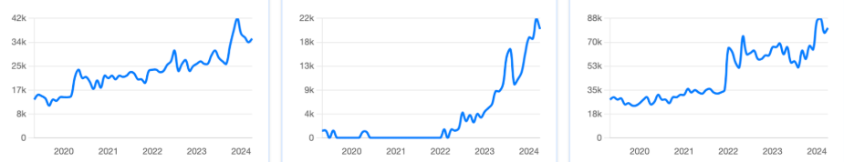

# plot2data

Extract numerical data from an image of a plot, entirely in your browser.

You have a screenshot of a line or scatter chart and you want the numbers back.
Drop the image in, crop to one plot, check the four axis anchors, download a CSV.
Nothing is uploaded: the whole pipeline, OCR included, runs on your machine and works offline.



## What it is good at

Clean, publication-style line and scatter plots on rectangular Cartesian axes - the kind used as illustrative graphics in reports and articles.
Measured error over the synthetic corpus is **0.03% to 0.20% of full scale**; see [ACCURACY.md](ACCURACY.md) for the numbers and how they were obtained.

It handles, and is tested on:

- linear and logarithmic axes, including `10^n` superscript decade labels
- abbreviated tick labels (`42k`, `1.5M`, `3bn`), percentages, currencies, thousands separators and decimal commas
- matplotlib-style `1e6` axis multiplier annotations, surfaced for confirmation rather than applied silently
- multiple series separated by colour, solid and dashed lines, markers, and light and dark themes
- charts with no y-axis line, non-white backgrounds, faint or dotted gridlines, and JPEG compression
- text printed *inside* the plot area in the same colour as the series it labels

## What it is not for

Heavily occluded curves, hand-drawn charts, photos of screens, perspective correction, pie/polar/3D charts, stacked areas and heatmaps.
Choosing a suitable image is the user's job. If the tool cannot read a plot confidently it says so rather than guessing.

## Running it

Node 24 and npm 11.

```sh
npm install
npm run dev      # http://localhost:5173
npm run build    # static bundle in dist/
npm test         # engine unit tests and the measured-accuracy suite
```

`dist/index.html` is a single self-contained page: the script and stylesheet are inlined into it, so it runs from any static host
*and* by opening it straight from the filesystem. Over `file://` the browser refuses to start a web worker, so OCR is skipped and the
tool says so; you type the four anchor values in and everything else - detection, tracing, export - works exactly the same.

Other scripts:

```sh
npm run corpus     # regenerate the synthetic corpus with headless Chrome
npm run report     # regenerate ACCURACY.md from a live run
npm run accuracy   # print the per-case accuracy table
```

## Using it

1. **Load** a PNG or JPEG: drop it on the page, pick it with the file button, or paste from the clipboard.
2. **Crop** to a single plot. Include the axes and their tick labels; leave out titles, legends outside the frame, and neighbouring panels.
3. **Extract**. The tool finds the plot frame, the ticks, the series, and reads the tick labels.
4. **Check the calibration.** Four anchors - two on x, two on y - are always shown and always editable.
   Drag an anchor's guide line on the image, or type its pixel position and its value.
   The live mapping statement under them ("x: 0 to 12, linear") is what will be used; if it looks wrong, it is wrong.
5. **Export.** Choose a point count, or "native" for one point per pixel column, and download the CSV.

Anything the tool is unsure about appears as a warning in the panel and again in the CSV header: an ambiguous linear/log axis,
a tick label discarded as a misread, a multiplier annotation it wants confirmed, a plot frame it could not identify.

### Calibration is the whole ballgame

A wrong calibration is a silently wrong answer, so the design gives it no room to hide:

- The mapping is **always two visible, editable anchors**. Whatever fitting happens underneath, what ships to the CSV is a mapping you had the chance to check.
- Anchors are pre-filled by a **least-squares fit over every readable tick**, not by trusting two of them.
  Real charts round their printed tick values (`0, 4k, 9k, 13k, 18k, 22k` for evenly spaced pixels); a two-point fit inherits the rounding error of exactly those two labels.
- **Linear versus log is decided, not assumed.** Two labelled ticks fit both models, so with fewer than three the tool says so and defaults to linear with the toggle made obvious.
  With three or more it compares residuals under both models and picks the fit.
- A label that disagrees wildly with the rest is **discarded as a misread and reported**, not averaged in.
- Uncertainty comes from the drawn line's own thickness and the axis scale. A 3 px line over a 600 px axis spanning 0-100 is ±0.25 no matter how good the algorithm is; that number is shown in the UI and written into the CSV.

### Markers versus curve

- **Marker mode** returns the centroid of each detected marker blob. Those are real samples and are the high-fidelity result.
- **Curve mode** traces the drawn path and resamples it. The CSV header says plainly that the rows are a resampling of a drawn curve, not the original data points.

The mode is chosen from the shape of the ink - a marker is a compact filled blob, a dash is an elongated sliver - and can be overridden before extraction.

## The engine

The extraction engine lives in [`src/engine/`](src/engine) and is **pure TypeScript with no DOM dependency**.
It operates on plain RGBA buffers, so the same code runs in the browser, under `node --test`/vitest, and inside the Android wrapper.
The UI is a thin layer over it.

```ts
import { analyse, buildSeries, toCsv } from './src/engine/index.ts';

// `image` is { width, height, data: Uint8ClampedArray } in RGBA order.
const analysis = await analyse(image, { ocr });      // ocr is optional
const series = buildSeries(analysis, { resample: { kind: 'uniform', count: 100 } });
const csv = toCsv(analysis, series, { source: 'chart.png' });
```

### Public API

| Function | What it does |
| --- | --- |
| `analyse(image, options)` | Runs the whole pipeline: frame, ticks, labels, calibration, segmentation, tracing. Returns everything in pixel space. Expensive; call once. |
| `buildSeries(analysis, options)` | Applies a calibration to the traced series and resamples. Cheap; call on every anchor edit. |
| `toCsv(analysis, series, options)` | Serialises to CSV with the calibration, uncertainty and warnings in the header. |
| `detectFrame(image)` | Plot rectangle, axis spines, background colour, dark-theme flag. |
| `detectTicks(image, frame, side)` | Tick positions, geometrically, with a label-blob fallback for charts that draw no tick marks. |
| `readTickLabels(image, frame, scan, ocr)` | Reads the labels next to the ticks through an injected `OcrProvider`. |
| `parseLabel(text)` | Parses one tick label: suffixes, units, separators, scientific and `10^n` forms. |
| `calibrateAxis(side, ticks, pxLo, pxHi, override)` | Least-squares calibration with linear/log selection and misread rejection. |
| `pixelToValue(cal, px)` / `valueToPixel(cal, value)` | The mapping itself. |
| `findSeriesCandidates(image, frame)` | Candidate series colours over the plot interior. |
| `buildMask` / `findComponents` / `selectDataComponents` | Per-series coverage mask, its connected components, and the data-versus-text decision. |
| `traceCurve(mask)` / `traceMarkers(components)` | Sub-pixel path tracing and marker centroids. |
| `estimateUncertainty(cal, thickness, strokeWidth)` | Uncertainty in data units from the line's thickness. |

`OcrProvider` is an interface so the engine stays DOM-free:

```ts
interface OcrProvider {
  recognise(image: ImageBuffer, hint?: { charset?: string }): Promise<{ text: string; confidence?: number }>;
}
```

The browser implementation is [`src/ui/ocr.ts`](src/ui/ocr.ts) (tesseract.js with the worker, WASM core and language data served from the bundle);
the Node one used by the tests is [`test/helpers/node-ocr.ts`](test/helpers/node-ocr.ts).
Pass `null` and the tool still works fully by manual anchor placement.

## Layout

```
src/engine/     the extraction engine, no DOM
src/ui/         canvas stage, browser OCR, image IO
tools/          corpus generator, accuracy report, diagnostics
test/           unit tests and the measured-accuracy suite
corpus/         synthetic plots, ground-truth CSVs and case metadata
examples/real/  the four real screenshots used as the acceptance corpus
public/         tessdata; the tesseract worker and core are copied in by `npm run assets`
```
